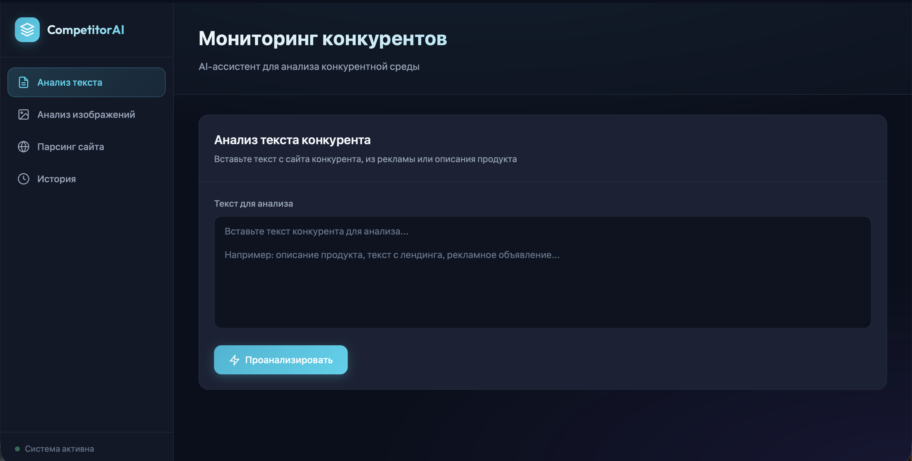

# CompetitorAI: AI-анализ конкурентов по тексту, картинкам и сайтам

Веб-приложение разбирает материалы конкурентов: текст с сайта, баннер или скриншот, страницу по ссылке. В ответ приходит структурированный анализ с сильными и слабыми сторонами и рекомендациями. Есть и десктоп-версия на PyQt6.



## О проекте

Это MVP мультимодального ассистента: модель работает и с текстом, и с изображениями. Пользователь выбирает режим (текст, изображение или сайт), отправляет материал и через несколько секунд получает отчет. Последние 10 запросов сохраняются в истории, к ним можно вернуться и сравнить конкурентов.

## Задача

Чтобы понимать рынок, нужно регулярно смотреть, что делают конкуренты: как описывают услуги, как оформляют сайты и рекламу, что обещают клиентам. Вручную это значит открывать десятки страниц, читать тексты, разглядывать баннеры и самой делать выводы. Это долго, и выводы сильно зависят от того, кто смотрит.

## Решение

1. **Анализ текста.** Текст конкурента (от 10 символов) превращается в отчет: сильные стороны, слабые стороны, уникальные предложения, рекомендации и короткое резюме.
2. **Анализ изображений.** Баннер, скриншот сайта или фото упаковки (PNG, JPG, GIF, WEBP). Модель описывает изображение, дает маркетинговые наблюдения, оценивает визуальный стиль по шкале от 0 до 10 и предлагает улучшения.
3. **Анализ сайта по ссылке.** Selenium открывает страницу в headless Chrome, достает заголовок, H1 и первый абзац и снимает скриншот. Модель анализирует скриншот вместе с текстом.
4. **История.** Тип запроса, краткое описание и время последних 10 запросов.
5. **Две оболочки.** Веб-интерфейс в браузере и десктоп-приложение на PyQt6, которое работает с тем же сервером.

## Как это выглядит

| Анализ текста | Анализ изображения | Анализ сайта |
|:-:|:-:|:-:|
|  |  |  |

Видео работы каждого режима лежат в `demo/`: анализ текста, изображения, сайта и история запросов.

## Результат

- Отчет по тексту, картинке или сайту конкурента приходит за несколько секунд вместо ручного разбора.
- Все отчеты построены по одной схеме, поэтому конкурентов легко сравнивать между собой.
- Анализ сайта не требует ничего копировать: достаточно ссылки.

Что пока не так. Это MVP: каждый анализ запускается вручную, регулярного обхода сайтов и уведомлений об изменениях здесь нет. Десктоп-версии нужен отдельно запущенный сервер.

## Стек технологий

| Технология | Зачем используется |
|---|---|
| **Python** | Язык сервера и десктоп-приложения, в контейнере 3.12 |
| **FastAPI + Uvicorn** | Сервер: анализ текста, изображений и сайтов, история, документация API |
| **OpenAI API через ProxyAPI** | Анализ текста и изображений. Модель по умолчанию `gpt-4o-mini` |
| **Selenium + Chromium** | Открывает сайт конкурента, достает текст и снимает скриншот |
| **Pydantic** | Проверка входных данных и схемы отчетов |
| **Pillow** | Обработка загруженных изображений |
| **HTML, CSS, JavaScript** | Веб-интерфейс без фреймворков |
| **PyQt6 + PyInstaller** | Десктоп-приложение и его сборка в `.exe` или `.app` |
| **Docker Compose** | Запуск сервера с Chromium внутри |

## Структура репозитория

- `backend/`: сервер на FastAPI. Настройки, схемы данных, сервисы для модели, парсинга сайтов и истории.
- `frontend/`: веб-интерфейс.
- `desktop/`: десктоп-приложение. Как его собрать, описано в `desktop/README.md`.
- `run.py`: запуск сервера.
- `docs.md`: описание API с примерами запросов.
- `demo/`: скриншоты и видео.

## Запуск

Нужен Python 3 и ключ [ProxyAPI](https://proxyapi.ru/) (OpenAI-совместимый доступ). Для анализа сайтов нужен установленный Chrome или Chromium.

```bash
python -m venv venv && source venv/bin/activate
pip install -r requirements.txt
cp env.example.txt .env       # PROXY_API_KEY, модели по желанию
python run.py                 # http://localhost:8000
```

Документация API после запуска: `http://localhost:8000/docs`.

В Docker: `docker compose up -d --build`, интерфейс откроется на `http://127.0.0.1:8003`. Chromium уже в образе.

## Автор

Татьяна Дзюбас, AI-инженер по автоматизации. Делаю Telegram-ботов, RAG-ассистентов и LLM-агентов, которые снимают рутину с небольших команд. Кейсы и контакты на [tatidzufri.com](https://tatidzufri.com).
