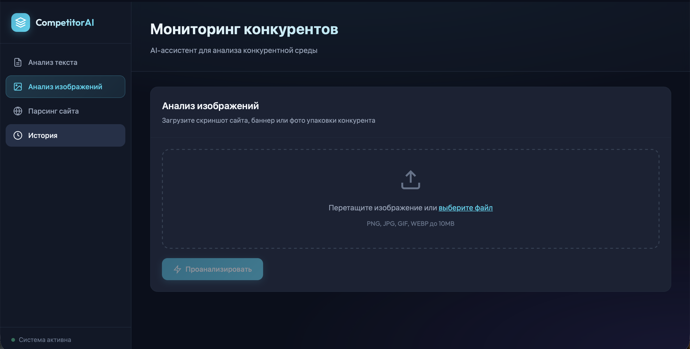
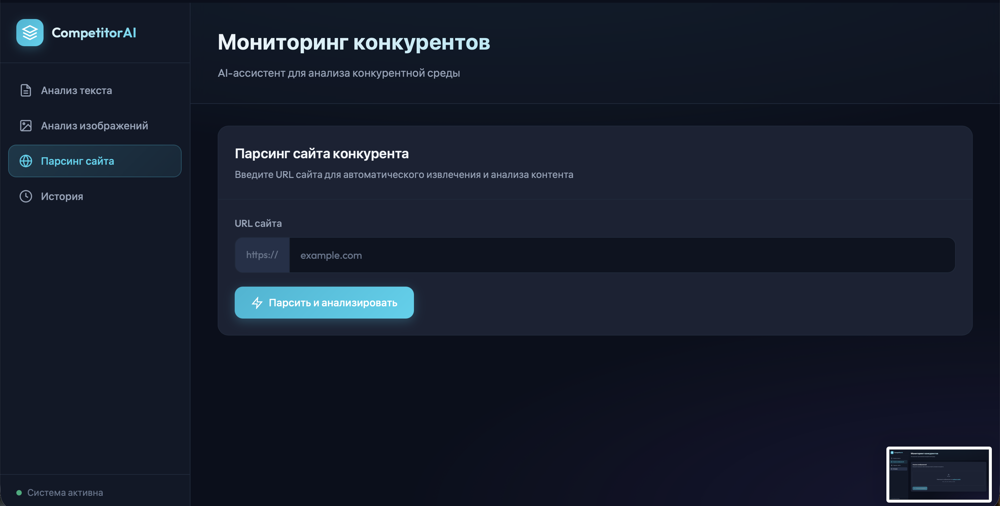
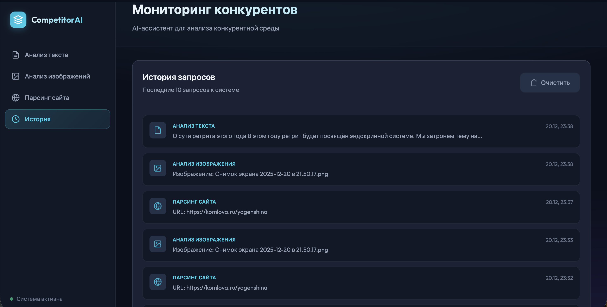

# CompetitorAI: AI analysis of competitor texts, images and websites

A web app that takes apart competitor materials: text from a website, a banner or screenshot, a page by its link. It returns a structured analysis with strengths, weaknesses and recommendations. There's also a desktop version on PyQt6.

This is a practice project. The interface works in Russian and English. Live demo: [competitor.tatidzufri.com](https://competitor.tatidzufri.com). Case study: [tatidzufri.com/en/case/competitor-ai](https://tatidzufri.com/en/case/competitor-ai).


## About the project

This is an MVP of a multimodal assistant: the model works with both text and images. The user picks a mode (text, image or website), sends the material and gets a report. The last 10 requests are kept in a history, so you can come back to them and compare competitors.

## The task

To understand a market you have to keep looking at what competitors do: how they describe their services, how they design their sites and ads, what they promise customers. By hand that means opening dozens of pages, reading texts, studying banners and drawing conclusions yourself. It takes long, and the conclusions depend a lot on who's looking.

## How it works

1. **Text analysis.** A competitor's text (10 characters or more) becomes a report: strengths, weaknesses, unique offers, recommendations and a short summary.
2. **Image analysis.** A banner, a site screenshot or a packaging photo (PNG, JPG, GIF, WEBP). The model describes the image, gives marketing observations, rates the visual style from 0 to 10 and suggests improvements.
3. **Website analysis by link.** Selenium opens the page in headless Chrome, pulls the title, H1 and first paragraph and takes a screenshot. The model analyzes the screenshot together with the text.
4. **History.** Request type, a short description and the time of the last 10 requests.
5. **Two front ends.** A web interface in the browser and a PyQt6 desktop app that talks to the same server.

## What it looks like

| Text analysis | Image analysis | Website analysis |
|:-:|:-:|:-:|
|  |  |  |

Videos of each mode are in `demo/`: text, image and website analysis, and the request history.

## Results

- A report on a competitor's text, image or site, instead of going through it by hand.
- Every report follows the same structure, so competitors are easy to compare.
- Website analysis needs nothing copied: a link is enough.

What's not there yet. This is an MVP: each analysis is started by hand, and there's no scheduled crawling of sites or change alerts. The desktop version needs the server running separately.

## Tech stack

| Technology | What it's for |
|---|---|
| **Python** | Server and desktop app language, 3.12 in the container |
| **FastAPI + Uvicorn** | The server: text, image and site analysis, history, API docs |
| **OpenAI API via ProxyAPI** | Text and image analysis. Default model `gpt-4o-mini` |
| **Selenium + Chromium** | Opens the competitor's site, pulls the text and takes a screenshot |
| **Pydantic** | Input validation and report schemas |
| **Pillow** | Processing uploaded images |
| **HTML, CSS, JavaScript** | Web interface with no framework |
| **PyQt6 + PyInstaller** | The desktop app and its build into `.exe` or `.app` |
| **Docker Compose** | Runs the server with Chromium inside |

## Repository structure

- `backend/`: the FastAPI server. Settings, data schemas, services for the model, site parsing and history.
- `frontend/`: the web interface.
- `desktop/`: the desktop app. How to build it is in `desktop/README.md`.
- `run.py`: starts the server.
- `docs.md`: API description with request examples.
- `demo/`: screenshots and videos.

## Running it

You need Python 3 and a [ProxyAPI](https://proxyapi.ru/) key (OpenAI-compatible access). Website analysis needs Chrome or Chromium installed.

```bash
python -m venv venv && source venv/bin/activate
pip install -r requirements.txt
cp env.example.txt .env       # PROXY_API_KEY, models optional
python run.py                 # http://localhost:8000
```

API docs after start: `http://localhost:8000/docs`.

With Docker: `docker compose up -d --build`; the interface opens on `http://127.0.0.1:8003`. Chromium is already in the image.

## Author

Tetiana Dziubas, AI automation engineer. I build Telegram bots, RAG assistants and LLM agents that take routine work off small teams. Case studies and contact: [tatidzufri.com/en](https://tatidzufri.com/en/).
